<div align="center">


# Verdantix

### The living campus: detect it, fix it, prove it.

A live AI digital twin of **Dayananda Sagar University, Harohalli** that finds energy, water and waste problems,
sends the right team, and only closes a job when there is proof it was fixed.

[](https://verdantix-frontend.vercel.app)
[](https://github.com/princemittalr/verdantix/releases/latest)

[](https://github.com/princemittalr/verdantix/actions/workflows/ci.yml)


**CodeClash 2.0 · Problem Statement 2: AI-Powered Sustainable Campus**

[Try it](#-try-it-in-2-minutes) · [Access codes](#-access-codes-for-judges) · [Download the app](#-download-the-android-app) · [Features](#-features) · [Screenshots](#-screenshots) · [Architecture](#-architecture) · [Run locally](#-run-it-locally) · [Honest limits](#-honest-limits)

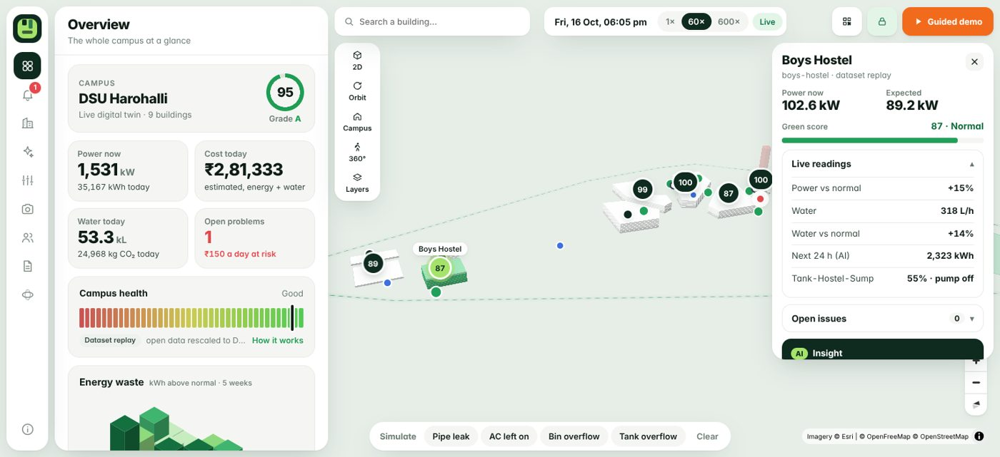

</div>

---

## 💡 Why Verdantix

DSU's own numbers (NIRF SDG 2026 submission) show the problem:

| | 2022-23 | 2023-24 | 2024-25 |
|---|---:|---:|---:|
| Electricity used | 3.00 GWh | 4.92 GWh | **5.89 GWh** |

- **≈ 4,280 t CO₂ a year** from that grid electricity (5,891,518 kWh × 0.727 t/MWh, CEA CO₂ Baseline Database FY 2023-24; our calculation).
- **1.7 %** of it comes from on-campus solar (102 MWh from 70 kWp).
- **109.5 t** of solid waste in 2024-25.

Yearly totals say *how much*. They can't say **where, when, or who should fix it**. Verdantix turns them into problems you can see, assign and close, with proof.

## 🔁 How it works

Every problem, from any source, goes through the same loop:

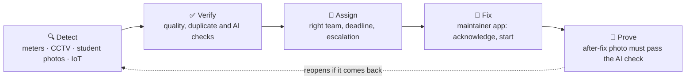

## 🚀 Try it in 2 minutes

| App | Link | Who it's for |
|---|---|---|
| 🖥️ **Operator website** | **https://verdantix-frontend.vercel.app** | Facilities admins: the whole campus |
| 📱 **Student reporter** | https://verdantix-frontend.vercel.app/report · [APK](#-download-the-android-app) | Students and faculty: no sign-in |
| 🧰 **Maintainer app** | https://verdantix-frontend.vercel.app/maintainer | Maintenance staff: their jobs only |

1. Open the **operator website**, click **Operator sign-in** and enter the operator code below.
2. Press **▶ Guided demo** in the header. It walks through a night leak → work order → tank overflow → empty-room AC → bin route → copilot → what-if → student QR (→ to skip, Esc to stop).
3. Or try a scenario yourself: **Try a scenario → Bin overflow**. Each one explains what it represents, its assumptions and the maths before it runs.
4. On your phone, open the **reporter**, tap *Garbage*, take a photo and send it. It appears on the twin within seconds.
5. Assign that incident to a team, then open the **maintainer app** with the maintainer code and acknowledge the job.

> [!NOTE]
> The backend runs on Render's free tier. If the site has been idle, the first load can take about 30–50 seconds while the server wakes up. After that it's fast.

## 🔑 Access codes for judges

| Role | Where to enter it | Code | What it allows |
|---|---|---|---|
| **Operator (admin)** | Website → **Operator sign-in** | `vx-ops-67460b2d` | Everything: incidents, assign / verify / close work orders, scenarios, clock, CCTV, backup, audit log |
| **Maintainer** | `/maintainer` → sign-in screen | `vx-maint-2ac02f9f` | Their work orders: acknowledge, start work, notes, after-fix photo, directions. **Cannot** close or cancel |
| **Student / public** | `/report` | *none needed* | Report problems, see Green Points and badges |

The role is decided **on the server** from the code (`/api/whoami`), never by the page. A maintainer code gets `401` on admin actions and `403` if it tries to close or cancel an order.

> [!WARNING]
> These are **demo codes for the CodeClash 2.0 judging period**. They will be rotated after judging. Never put real production passcodes in a README.

## 📲 Download the Android app

The student reporter is packaged as an Android app (a Trusted Web Activity built with PWABuilder). It loads the live `/report` page, so it always has the latest version without a reinstall.

1. On your Android phone, open **[Releases → latest](https://github.com/princemittalr/verdantix/releases/latest)**.
2. Under **Assets**, tap **`Verdantix.apk`** to download it.
3. Open the downloaded file. If Android asks, allow **Install unknown apps** for your browser (Settings → Apps → *your browser* → Install unknown apps).
4. Tap **Install**, then open **Verdantix**. Allow **camera** and **location** when asked, so it can attach a photo and find the building you're in.

> [!TIP]
> **No APK? Install it from the browser instead.** Open https://verdantix-frontend.vercel.app/report in Chrome → ⋮ menu → **Add to Home screen / Install app**. The **maintainer app** installs the same way from `/maintainer`. On iPhone, use Safari → Share → **Add to Home Screen**.

Google Play Protect may warn that the app is from an unknown developer. That's expected for an app installed outside the Play Store. Tap **Install anyway**.

## ✨ Features

### 🏙️ Digital twin
- **3D campus** drawn from satellite imagery: buildings floor by floor, hostels, food court, bins, cameras and water tanks, with a satellite layer.
- **Live green score** per building from power and water against its learned normal, with grades A–D on a leaderboard.
- **Building card** with live readings, a day-ahead forecast, an AI insight and DSU's 360° virtual tour.
- **Simulation clock** replays real meter datasets at 1×, 60× or 600×.

### ⚡ Energy, 💧 water, 🗑️ waste
| | How it detects |
|---|---|
| **Energy** | Hour-of-week z-score confirmed by an Isolation Forest; AC and lights running in empty rooms or after hours; day-ahead forecast (gradient-boosted trees) |
| **Water** | Minimum-night-flow leak detection on the campus inlet, evaluated on 14 labelled bursts; tank overflow and pumping in peak-tariff hours |
| **Waste** | Bin fill model with time-to-full, AI waste vision (box, material and confidence per object), 9 waste types each routed to the right team and deadline (biomedical: clinic, 2 h) |
| **CO₂** | Scope 2 CO₂e per building: kWh × 0.727 kg/kWh (CEA, FY 2023-24), with the method shown |

### 🤖 AI
- **Waste and problem vision:** Gemini vision in the cloud; YOLO11n + CLIP locally. A **photo-quality gate** rejects blurry, dark or blank photos before any AI call.
- **CCTV auto-reporting:** any webcam, video or RTSP feed raises an incident after 2 detections and closes it after 3 clean frames.
- **GenAI copilot** over live twin data, with voice, in **English, Kannada and Hindi**. Gemini → Groq → local Qwen2.5 → rule-based fallback. It cites alert IDs and never invents numbers.
- **Eco advisor:** today's priorities from rules (no LLM, so no made-up numbers).
- **Hotspots:** DBSCAN clusters with the usual time window, a suggested patrol time and the recurrence.

### 📊 Planning
- **What-if and payback:** before/after for energy, bill, CO₂, water and bin overflow over a full year (AC setpoint, after-hours load, LED, solar, leaks, smart pumping).
- **Collection route simulator:** fixed round vs smart round (nearest neighbour + 2-opt), with one documented cost method; both routes drawn on the map.
- **Guided scenarios** explain each simulated problem: what it is, inputs, what's detected, the action and the impact maths.
- **Weekly sustainability report** as a PDF ([sample](sample-weekly-report.pdf)).

### 👥 People
- **Student reporter:** category, photo, GPS building detection, **offline outbox**, Green Points and badges. Reports without a photo are verified when 3 people confirm.
- **Maintainer app:** jobs sorted overdue-first with a 4-step progress bar, a map with you and the problem, straight-line distance, a walking estimate, Google Maps directions and an after-fix photo upload.
- **Accountability:** work orders with deadlines (water 4 h, waste 6 h, energy 24 h), overdue escalation, a timeline and an append-only audit log.

## 📸 Screenshots

<table>
<tr>
<td width="50%">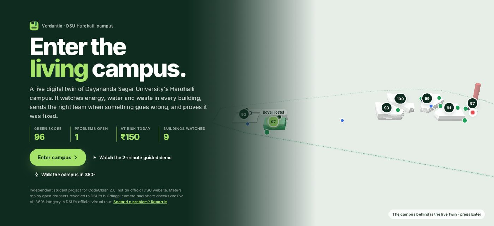<br><sub><b>Landing</b>: enter the living campus</sub></td>
<td width="50%">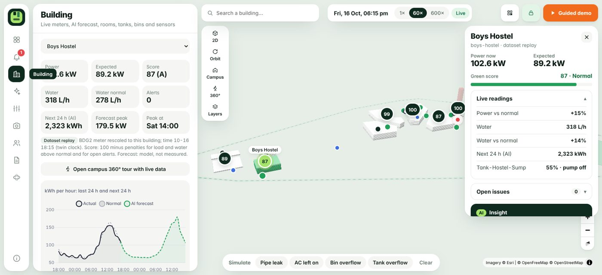<br><sub><b>Building</b>: live readings, forecast and AI insight</sub></td>
</tr>
<tr>
<td>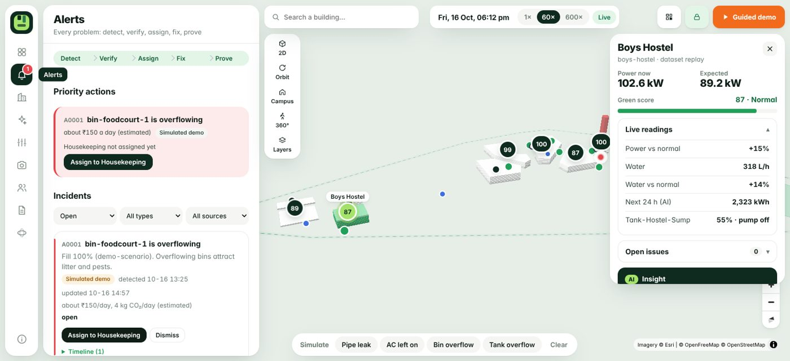<br><sub><b>Alerts</b>: priority actions and one-click assign</sub></td>
<td>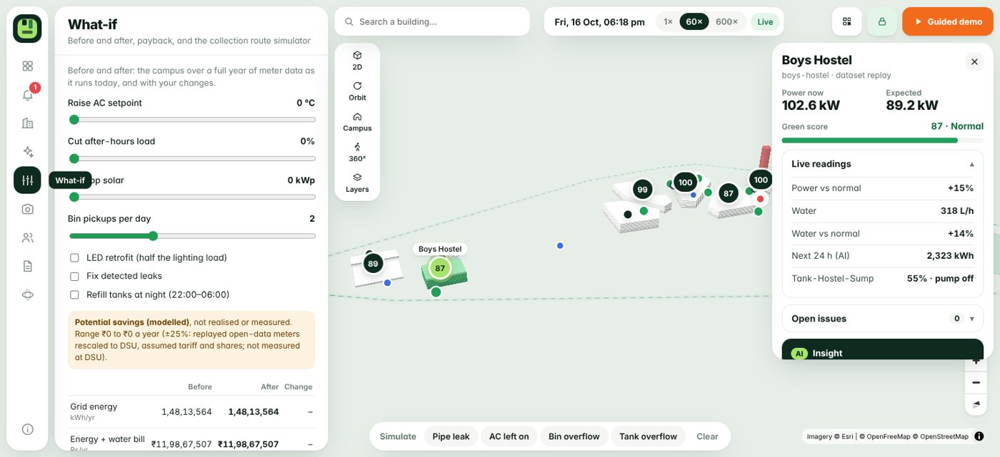<br><sub><b>What-if</b>: before/after, payback and route simulator</sub></td>
</tr>
<tr>
<td>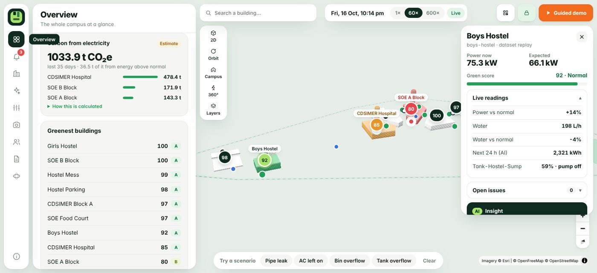<br><sub><b>Carbon</b>: CO₂ per building with the method</sub></td>
<td>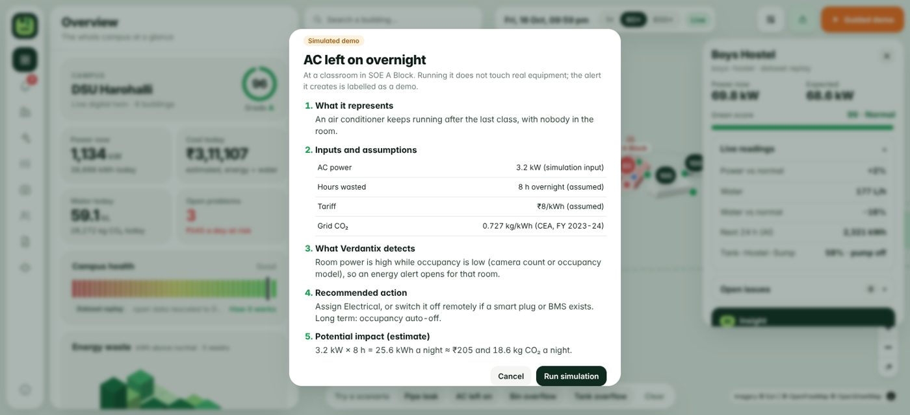<br><sub><b>Guided scenario</b>: every simulation explained</sub></td>
</tr>
</table>

<p align="center">
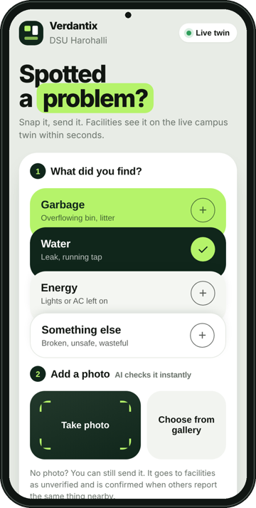
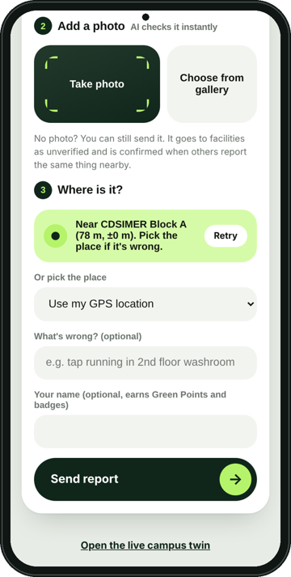
&nbsp;&nbsp;&nbsp;
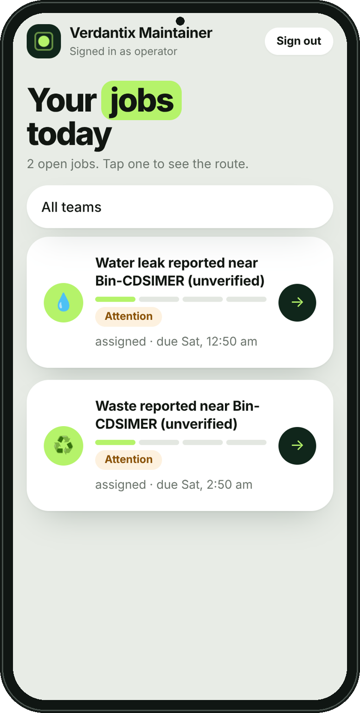
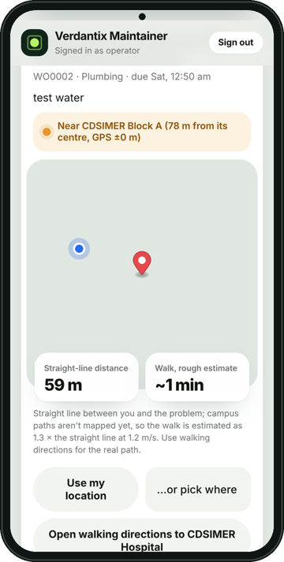
<br>
<sub><b>Student reporter</b> (left) · <b>Maintainer app</b> (right)</sub>
</p>

## 🏗️ Architecture

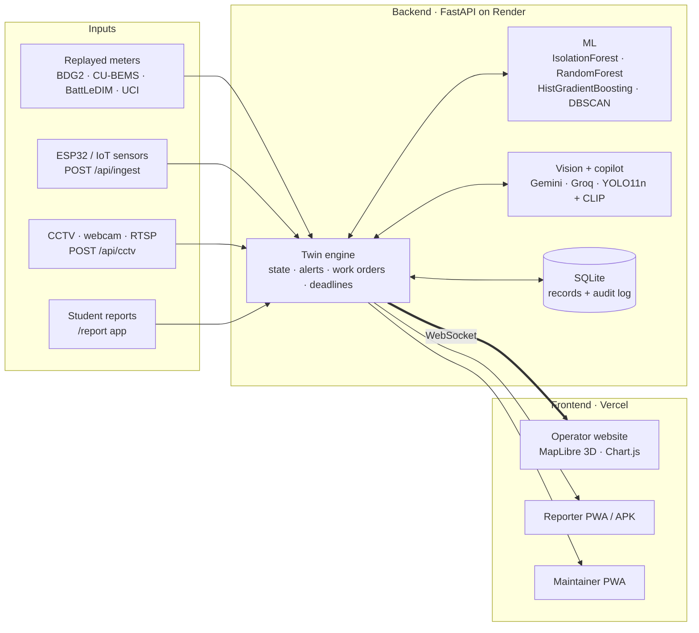

| Layer | Tech |
|---|---|
| Backend | Python 3.12, FastAPI, scikit-learn, SQLite, WebSocket |
| Frontend | Vanilla JS, MapLibre GL (OpenFreeMap + satellite tiles), Chart.js, PWA service worker |
| AI | Gemini (vision + copilot), Groq, local Qwen2.5-1.5B, YOLO11n, CLIP ViT-B/32 |
| Mobile | PWA + Trusted Web Activity APK (PWABuilder) |
| Hosting | Render (backend, lite mode) + Vercel (frontend): **₹0** on free tiers |
| Hardware | ESP32 sensor sketch in [`hardware/`](hardware/) |

## 🛠️ Run it locally

**Requirements:** Python 3.12. The full mode needs about 4 GB RAM for PyTorch; lite mode doesn't.

```bash
git clone https://github.com/princemittalr/verdantix.git
cd verdantix
python -m venv venv
# Windows: venv\Scripts\activate    macOS/Linux: source venv/bin/activate
pip install -r requirements.txt          # or requirements-lite.txt (no PyTorch)
cp .env.example .env                     # add GEMINI_API_KEY / GROQ_API_KEY and your own tokens
python scripts/build_campus.py
python scripts/prepare_data.py           # needs the open datasets (see Data)
python -m uvicorn app:app --app-dir backend --port 8000
```

Open **http://localhost:8000** (website), **/report** (reporter) and **/maintainer** (maintainer).

<details>
<summary><b>Environment variables</b></summary>

| Variable | Purpose |
|---|---|
| `GEMINI_API_KEY`, `GROQ_API_KEY` | Vision and copilot (free tiers) |
| `OPERATOR_TOKEN` | Admin passcode (`X-Operator` header) |
| `MAINTAINER_TOKEN` | Maintainer passcode |
| `INGEST_TOKEN` | Sensor and CCTV token (`X-Token` header) |
| `VERDANTIX_LITE=1` | Lite mode: Gemini vision instead of YOLO/CLIP (fits in 512 MB) |
| `ALLOWED_ORIGINS` | CORS allow-list |
| `VERDANTIX_DB` | SQLite path |
| `CCTV_*` | CCTV thresholds |

See [`.env.example`](.env.example). In production (on Render, or with `VERDANTIX_ENV=production`) a missing token **disables** that capability instead of leaving it open.
</details>

<details>
<summary><b>Deploy your own (free)</b></summary>

- **Backend:** Render web service from [`render.yaml`](render.yaml) in lite mode. Set the variables above in the Render dashboard. A free uptime pinger on `/api/campus` keeps it awake.
- **Frontend:** Vercel with root directory `frontend`. `frontend/config.js` sets `window.VX_API` to the backend URL (it holds no secrets).
- **Android APK:** run [PWABuilder](https://www.pwabuilder.com) on `https://<your-site>/report`, then upload the APK to a GitHub Release. Never commit the APK or the signing key.
- **Full mode** (YOLO11n + CLIP on CPU) runs locally or on any VM via [`scripts/setup_vm.sh`](scripts/setup_vm.sh).
</details>

<details>
<summary><b>Connect real sensors and cameras</b></summary>

```bash
python scripts/fake_sensor.py                      # simulated ESP32 nodes
curl -X POST localhost:8000/api/ingest -H "Content-Type: application/json" -H "X-Token: $INGEST_TOKEN" \
     -d '{"sensor":"esp32-01","asset":"bin-soe-1","metric":"bin_fill","value":92}'
python scripts/cctv_agent.py <camera> <webcam|video|rtsp-url>
```
Metrics: `power_kw`, `water_lph`, `bin_fill`, `people`, `tank_level_pct`. `GET /api/sensors` lists live sensors and valid asset IDs. Fresh readings override the replay and run through the same detectors.
</details>

<details>
<summary><b>Key API endpoints</b></summary>

| Endpoint | Auth | What |
|---|---|---|
| `GET /api/state` | public | Live twin state |
| `WS /ws` | public | Live updates |
| `POST /api/reports` | public | Student report |
| `POST /api/ingest` | sensor | IoT reading |
| `POST /api/cctv/{camera}` | sensor | CCTV frame |
| `GET /api/route?pickups=2` | public | Route simulator |
| `GET /api/advisor` | public | Eco advisor |
| `POST /api/orders/{id}/status` | maintainer / admin | Work-order step |
| `POST /api/orders/{id}/proof` | maintainer / admin | After-fix photo |
| `GET /api/audit`, `GET /api/backup` | admin | Audit log, full backup |
| `GET /api/whoami` | any | Role of the given code |
</details>

## 🧪 Tests

```bash
python -m unittest discover -s tests -v
```
27 API tests run in CI on every push. They cover:
- **Roles and auth:** anonymous users can't run operator actions; maintainers can't close orders; production fails closed; sensor auth.
- **Inputs:** bad, oversized and wrong-format uploads.
- **Lifecycles:** CCTV incidents open, close and reopen; work-order transition rules; idempotent confirmations and points.
- **Safety:** vision outages raise nothing; rate limits work.
- **Persistence:** records survive a restart.

## 🔒 Security and trust

- **Server-side roles:** admin, maintainer and public. No secrets in frontend code.
- **Fails closed** in production when a token is missing.
- **Rate limits** per device, keyed on the Cloudflare client IP so they can't be dodged with a forged `X-Forwarded-For`.
- **Upload limits:** 8 MB cap; JPEG/PNG/WebP only; server-chosen filenames; 30-day photo retention.
- **Provenance on every number:** *Measured*, *Dataset replay*, *AI-inferred*, *Manual report*, *Simulated* or *Estimated*. A stale sensor is shown as stale, never as healthy.
- **Append-only audit log** of every operator action and report.

## 📚 Data and credits

DSU has no public meter data, so Verdantix maps real open datasets onto DSU's buildings, rescaled to Indian benchmark intensities. Live sensors plug into the same API.

| Need | Source |
|---|---|
| DSU baseline (energy, waste, area) | DSU NIRF SDG 2026 submission |
| Grid CO₂ factor | CEA CO₂ Baseline Database, FY 2023-24 (0.727 t/MWh) |
| Building energy and water | Building Data Genome 2, Miller et al., *Scientific Data* 2020 |
| Room AC, lighting and plugs | CU-BEMS, Pipattanasomporn et al., *Scientific Data* 2020 |
| Occupancy | UCI Occupancy Detection, Candanedo & Feldheim 2016 |
| Water network and leaks | BattLeDIM 2020, L-Town, Vrachimis et al. |
| Bin fill and overflow | Roboflow `garbage_fill_level` v2 (CC BY 4.0), `GarbageOverflow` v1 |
| Models | YOLO11n (Ultralytics, AGPL-3.0), CLIP ViT-B/32 (OpenAI, MIT), Qwen2.5 (Apache-2.0) |
| Segregation rules | MoEFCC Solid Waste Management Rules 2016 |

Some waste features (waste-type routing, the photo-quality gate, Green Points, the offline outbox) are adapted from the team's earlier [Clean City](https://github.com/pandeylakshya207-max/clean-city-app) project. All the code here is new.

## ⚖️ Honest limits

We'd rather you trust our numbers than be impressed by them:

- **Not DSU's meters yet.** Building data replays open datasets rescaled to DSU, and it is labelled *Dataset replay* in the app. Tanks and bins are simulated from that demand.
- **Vision isn't validated on DSU footage.** Operator labels are collected so precision can be measured in use.
- **Savings are potential, not measured.** Measuring them needs a before/after pilot with real meters. What-if results carry a ±25 % range.
- **Leak detection** uses one inlet signal (7 of 14 bursts caught within 3 days).
- **AI photo checks are not inspections.** Hazardous waste is always marked *confirm on site*.
- **Walking distance** is a straight line × 1.3 (campus paths aren't mapped). The app says so and links Google Maps directions.
- **Free hosting:** Render's free disk resets on redeploy, so operators can export everything from `/api/backup` first.
- **Accounts:** one shared code per role, not individual user accounts yet.

## 🗺️ Roadmap

- [x] 3D twin, anomaly detection, forecasting, work orders with proof
- [x] Student reporter APK, maintainer app, server-side roles
- [x] Waste vision, route simulator, what-if, CO₂, guided scenarios
- [ ] **Pilot 1:** clamp meters on one block plus 2 bin sensors to measure real savings
- [ ] **Pilot 2:** connect existing CCTV and measure AI precision from operator labels
- [ ] Postgres, a sign-in per person, all blocks, and a monthly report for DSU's NIRF filing

---

<div align="center">

Built at **CodeClash 2.0**, Dayananda Sagar University (15–16 Oct 2026) by **Team Verdantix**.

<sub>Verdantix is a student project and is not an official DSU system. The name is also used by an existing research firm; check before any commercial use.</sub>

</div>
